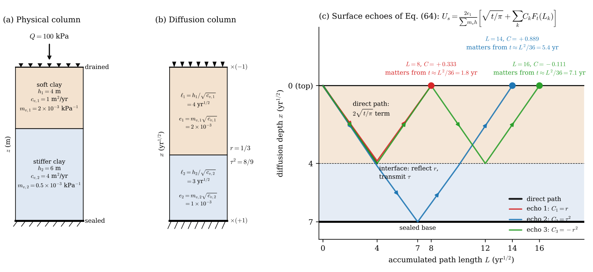
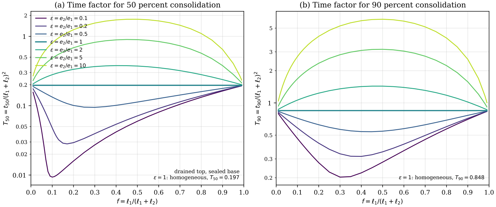
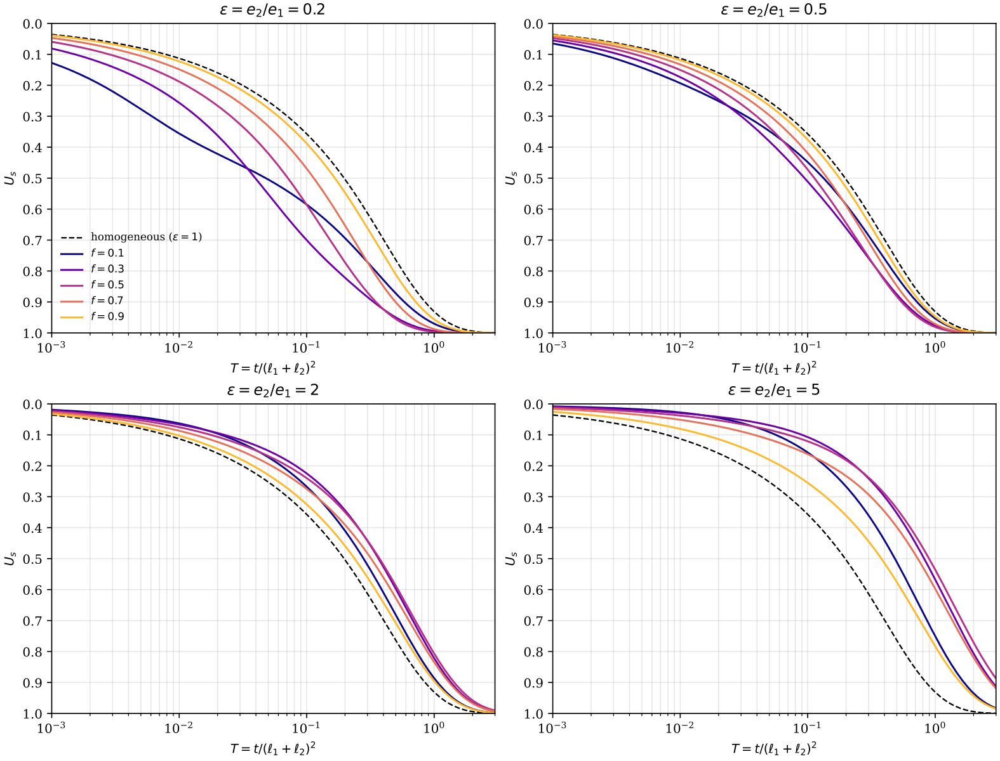
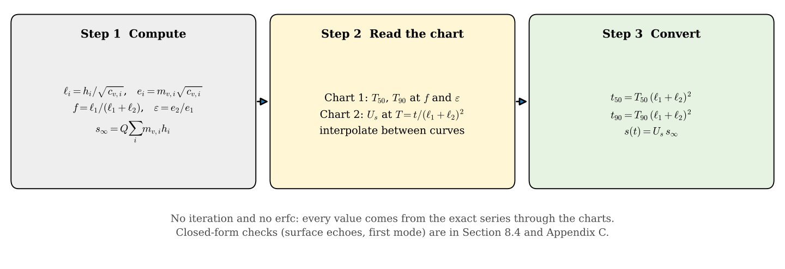
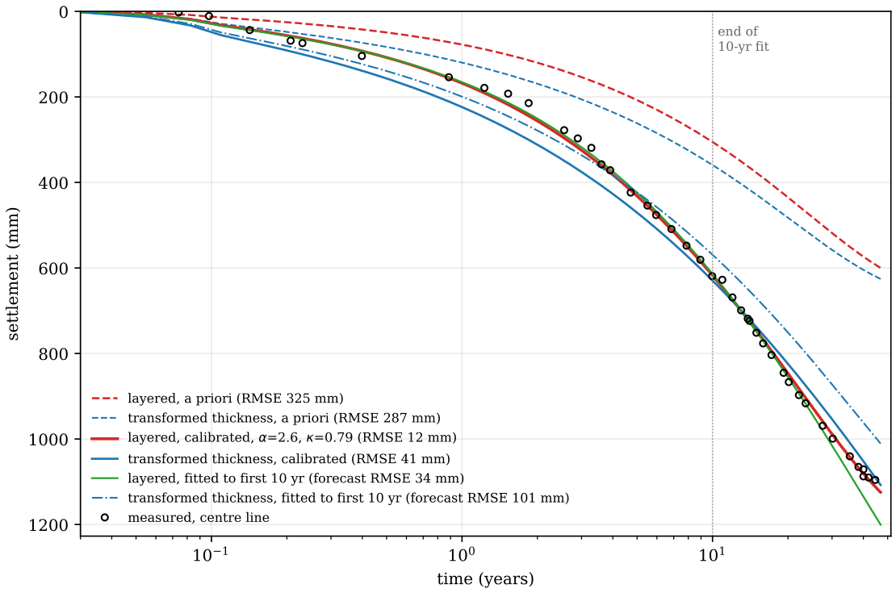
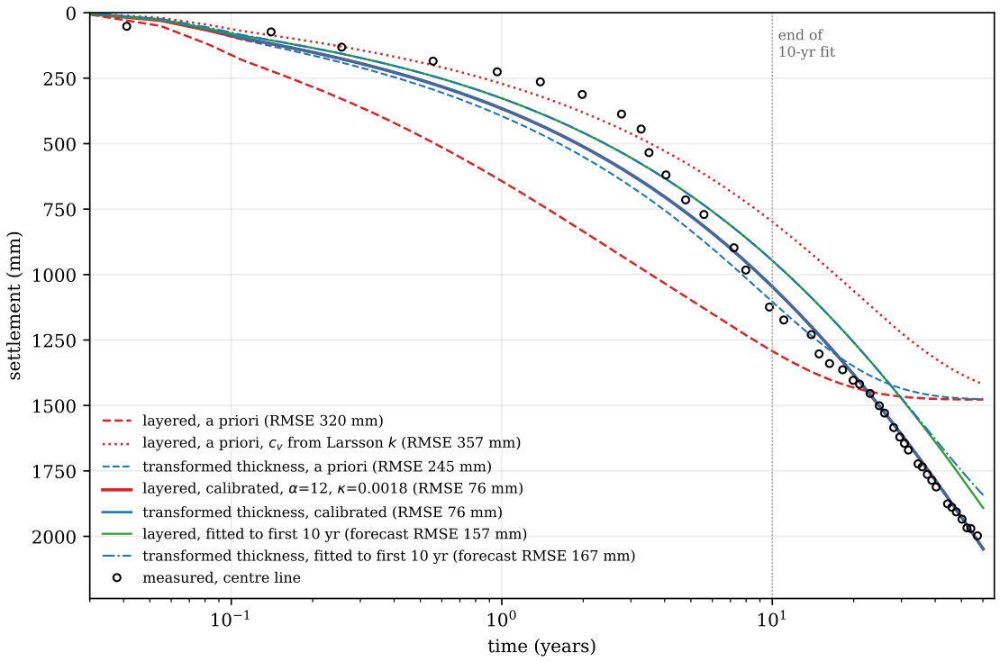
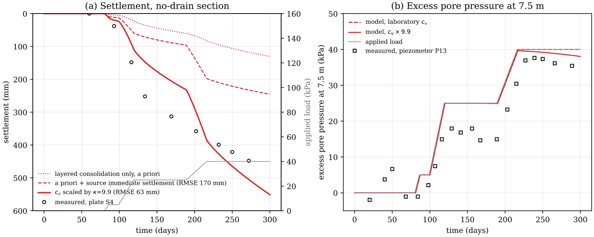
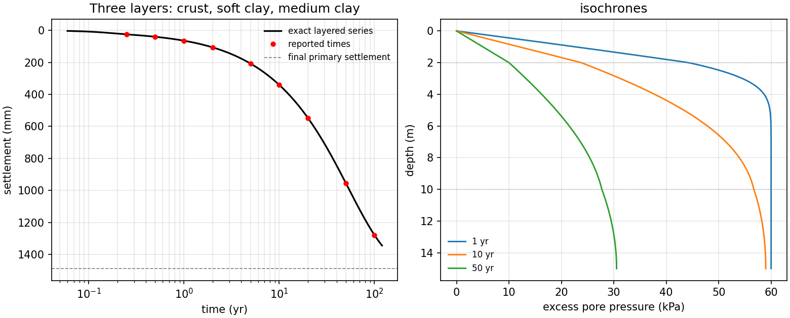

# terzaghi-layered

`terzaghi-layered` is a command-line tool for exact one-dimensional consolidation of
layered soil with any number of layers. Each layer has its own thickness, coefficient of
consolidation and compressibility, the top is drained, and the base is sealed or drained.
The tool reports settlement against time with a certified error interval, the times to
50 and 90 percent consolidation, and excess pore-pressure isochrones. It implements the
layered solution of the accompanying paper (Youwai and Kongkitkul, *Consolidation of
layered soils with certified error bounds*, draft 2026; AI Research Group, Department
of Civil Engineering, King Mongkut's University of Technology Thonburi) and reproduces its two-layer example to every printed digit.

## Results from the paper

The paper behind this tool derives an exact solution for consolidation of a layered
column and shows what it changes in practice. Its main results are the following.

- **The layered solution is exact and certified.** The degree of consolidation is
  either a spectral series with positive modal weights or an explicit series of
  complementary error functions whose coefficients need no eigenvalues. Each comes with
  a two-sided truncation interval, so the error is known rather than estimated. The two
  representations agree to about 2×10⁻¹³ on the paper's test profiles.
- **Independent permeability and compressibility laws get a bounded correction.** When
  the two laws do not share a common factor, a residual inequality bounds the settlement
  error by bulk, interface and boundary terms, and a lifted first-order correction
  cancels the interface flux mismatch at any number of modes. On two- and four-layer
  test profiles the correction cuts the maximum pressure error by factors of 8.5 to 35,
  with observed second-order convergence in the constitutive departure. The interface
  term supplies 43 to 70 percent of the bound. This tool implements the
  linear layered solution, not the correction.
- **Early settlement depends on the top layer alone.** Integrated for settlement, the
  reflection series reduces to the one-layer formula `U_s = 2 m_v1 sqrt(c_v1 t / pi) /
  sum(m_v h)` plus a few "echoes" that return to the drained surface. In the paper's
  worked example, three echoes reproduce the exact series within 10⁻⁶ up to 10 years,
  a time factor of about 0.2.
- **Layering shifts consolidation time strongly.** For two layers the result depends only
  on the share of the drainage path in the upper layer and on the effusivity ratio. When
  the lower layer has the larger effusivity, `t90` can be up to seven times the
  homogeneous value, and in the opposite case `t50` can be up to twenty times shorter.
  The textbook transformed-thickness method gives `U_s = 0.509` at 10 years in the paper's
  worked example, against the exact 0.632.
- **Design charts make it a hand calculation.** For two layers, two charts give `T50`,
  `T90` and `U_s` in three steps without iteration, within 0.004 of the exact `U_s` in the
  worked example. For three or more layers the charts become impractical, which is why
  this tool exists.
- **Field records separate primary consolidation from creep.** On the untreated
  Skå-Edeby test fill in Sweden, the exact layered solution with laboratory parameters
  gives about half the measured settlement over 45 years, matching earlier creep
  analyses. Calibrated, it follows the record within 12 mm and forecasts 35 years from
  the first 10 within 34 mm, about three times better than a single equivalent layer.
  At Lilla Mellösa, also in Sweden, the record is dominated by creep, and the Bangkok
  case at the RTN Dockyard shows how lateral drainage and immediate settlement can
  exceed one-dimensional consolidation.

### Figures from the paper

**How the method sees a layered column.** Each layer becomes a diffusion length, the
interface reflects and transmits, and settlement is the one-layer term plus echoes that
return to the drained surface.



**Design charts for two layers.** Chart 1 gives the exact time factors for 50 and 90
percent consolidation against the share `f` of the drainage path in the upper layer, for
effusivity ratios `ε = e2/e1` from 0.1 to 10; the flat line `ε = 1` is Terzaghi's
homogeneous layer. Chart 2 gives `U_s` against the time factor.





The hand procedure takes three steps and no iteration.



**Field cases.** At Skå-Edeby (Sweden, 45 years) the layered solution with laboratory
parameters gives about half the measured settlement; calibrated, it follows the record
within 12 mm and forecasts it from the first 10 years far better than a single
equivalent layer.



At Lilla Mellösa (Sweden, 57 years) creep dominates, so layered and single-layer models
reach the same error floor; the early record is governed by the upper layer alone.



At the RTN Dockyard on soft Bangkok clay the plate settled far more than one-dimensional
consolidation allows, while the piezometer at 7.5 m shows that the middle of the clay
hardly consolidated, which points to lateral drainage and immediate settlement.



## How it works

In diffusion coordinates each layer becomes a unit-diffusivity segment of length
`l_i = h_i / sqrt(c_v,i)` whose interfaces carry only the effusivity
`e_i = m_v,i * sqrt(c_v,i)`. The degree of settlement consolidation is then evaluated in
one of two exact forms, chosen automatically for each time:

- **Spectral series** for intermediate and late times. Because every modal weight is
  positive and the weights sum to one, keeping `k` modes gives a two-sided interval on
  `U_s`. The eigenvalues come from a monotone phase function, so no root can be missed.
- **Reflection-path series** for early times (sealed base). This is a sum of
  complementary error functions with a computable bound on every omitted term.

Staged and ramped loads are handled by superposition, which is exact for the linear model,
and a negative stage represents unloading or a loss of load by submergence.

## Install

```bash
cd git_terzaghi
pip install -e .            # installs the `terzaghi-layered` command
pip install -e ".[test]"    # adds pytest
```

It needs Python 3.10 or later with numpy, scipy and matplotlib.

## Use

Print an example case file for 2, 3 or 4 layers, edit it, and run it:

```bash
terzaghi-layered example --layers 3 > my_case.toml
terzaghi-layered run my_case.toml --csv settlement.csv --plot settlement.png
```

For a single load step you can give the layers on the command line as
`h,cv,mv[,name]` in m, m²/yr and 1/kPa, from top to bottom:

```bash
terzaghi-layered quick --layer 2,5,4e-4,crust --layer 8,1.2,2.5e-3,soft \
                       --layer 5,2.5,8e-4,medium --load 60 --times 1 10 50
```

Options for `run` are `--tol` (truncation tolerance on `U_s` per load step, default
1e-6), `--modes` (eigenmodes computed, default 200), `--csv` and `--plot`.

## Case file

Case files are TOML (or JSON with the same keys). The examples in `examples/` show every
option.

```toml
title = "Three layers: crust, soft clay, medium clay"
base = "sealed"          # "sealed" or "drained" bottom; the top is always drained
time_unit = "yr"         # "yr" or "day": applies to cv, load times and output times

[[layer]]                # one block per layer, from the top down
name = "soft clay"
h  = 8.0                 # m
cv = 1.2                 # m2/yr (m2/day if time_unit = "day")
mv = 2.5e-3              # 1/kPa

[[layer]]                # or give oedometer data and let the tool compute a secant mv
name = "very soft clay"
h = 4.0
cv = 1.1
e0 = 2.8
Cc = 1.2
Cr = 0.12
sigma_v0 = 18.0          # kPa at mid-layer
sigma_p  = 25.0          # kPa

[[load]]                 # one block per stage; start = end gives an instantaneous step
start = 0.0
end   = 0.164            # a ramp over 60 days
dq    = 60.0             # kPa; negative for unloading or loss of load

[output]
times = [0.5, 1, 2, 5, 10, 20, 50]
profile_times = [1, 10]  # optional isochrones
```

## Output

The run prints the layer table (diffusion length, effusivity and share of the final
settlement for each layer), the final primary settlement, `t50` and `t90` for a single
load step, a settlement table with lower and upper bounds, and isochrones at the profile
times. The optional CSV holds the settlement table and the optional plot shows the
settlement curve and the isochrones.

The plot from `terzaghi-layered run examples/3_layers.toml --plot out.png` looks like this:



## Verification

```bash
python -m pytest -q
```

The 20 tests check the solver against Terzaghi's homogeneous series (`T50 = 0.196731`,
`T90 = 0.848085`), the paper's two-layer example (`U_s(10 yr) = 0.632181`,
`t90 = 27.650 yr`, staged-load settlement 458.17 mm), an independent Crank–Nicolson
finite-difference solver on three- and four-layer profiles with sealed and drained bases
(agreement within 3e-6), and the consistency of the pore-pressure field with the
settlement.

## Scope

The model is linear, with constant `c_v` and `m_v` in each layer, small strain, saturated
soil, Darcy flow and one-dimensional deformation. A secant `m_v` taken over the load
increment represents a nonlinear e–log σ′ curve. Creep, lateral drainage, stress spread
under a finite embankment and vertical drains lie outside the model, and field records
usually contain all of them, so a calibrated `c_v` or `m_v` absorbs those effects rather
than measuring a soil property.
